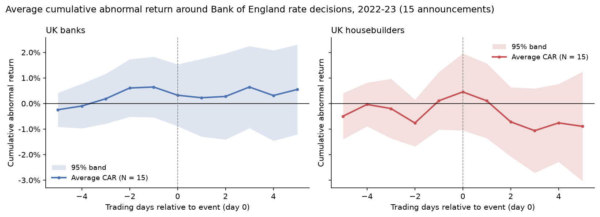

# Event Study Toolkit

[](https://github.com/Yogcarmen/event-study-toolkit/actions/workflows/ci.yml)

A small, tested Python toolkit for short-window event studies on daily stock returns: abnormal returns, cumulative abnormal returns (CARs) and the standard significance tests, in about 200 lines of readable code.



**Example finding:** across the 15 Bank of England rate decisions of 2022–23, neither UK banks nor UK housebuilders earned statistically significant abnormal returns on announcement days. Hikes in this cycle were largely anticipated, so the decision itself carried little new information for these sectors.

## Usage

```python
import pandas as pd
from eventstudy import EventStudy, load_prices, to_returns

rets = to_returns(load_prices(['LLOY.L', 'BARC.L', '^FTSE'], '2021-01-01', '2024-03-01'))
events = pd.DataFrame({'asset': ['LLOY.L', 'BARC.L'], 'date': ['2022-11-03', '2022-11-03']})

es = EventStudy(rets, events, market='^FTSE', estimation=(-250, -11), event=(-5, 5))
es.summary()   # CAAR + cross-sectional, BMP and sign tests for several windows
es.plot()      # average CAR with a 95% band
```

## What it does

For each (asset, event date) pair:

1. **Day 0** is the first trading day on or after the event date.
2. A **normal-return model** is fitted on an estimation window that ends before the event (default days −250 to −11):
   - `market`: OLS market model, R = α + β·Rₘ (default)
   - `mean`: constant-mean return
   - `adjusted`: market-adjusted return, R − Rₘ
3. **Abnormal returns** over the event window are the actual minus the predicted returns, cumulated into CARs.
4. **Tests** on the average CAR:
   - cross-sectional t-test (Brown & Warner, 1985)
   - standardised cross-sectional test (Boehmer, Musumeci & Poulsen, 1991), robust to the higher volatility often seen around events
   - sign test on the share of positive CARs

Events too close to the start or end of the data, or with too few estimation-window observations, are skipped and listed in `es.skipped`.

## Example: Bank of England rate decisions, 2022–23

`examples/boe_rate_decisions.py` asks whether rate-sensitive UK sectors reacted to the 15 MPC announcements between February 2022 and December 2023 (13 hikes, 2 holds; dates in `examples/data/boe_mpc_decisions.csv`).

- **Portfolios:** equal-weighted UK banks (Lloyds, Barclays, NatWest, HSBC, Standard Chartered) and UK housebuilders (Persimmon, Barratt Redrow, Taylor Wimpey, Berkeley).
- **Benchmark:** FTSE 100, market model estimated over days −250 to −11.
- **Why portfolios rather than single stocks:** stocks reacting to the same announcement are correlated. Treating 5 banks × 15 dates as 75 independent events would overstate significance, so each date counts once per sector.

| Portfolio | Window | CAAR | t (cross-sec.) | p | t (BMP) | p | Share positive |
|---|---|---|---|---|---|---|---|
| UK banks | [0, 0] | −0.32% | −0.95 | 0.36 | −0.86 | 0.40 | 40% |
| UK banks | [−1, +1] | −0.38% | −0.85 | 0.41 | −0.83 | 0.42 | 60% |
| UK banks | [0, +5] | −0.10% | −0.16 | 0.88 | −0.14 | 0.89 | 67% |
| UK housebuilders | [0, 0] | +0.35% | 0.63 | 0.54 | 0.42 | 0.68 | 60% |
| UK housebuilders | [−1, +1] | +0.87% | 1.29 | 0.22 | 1.28 | 0.22 | 67% |
| UK housebuilders | [0, +5] | −1.00% | −0.83 | 0.42 | −1.01 | 0.33 | 53% |

**Reading the results.**

- No window is significant at conventional levels for either sector.
- The signs on announcement day run against the simple story. Banks were slightly negative on the six days with hikes of 50bp or more (average day-0 abnormal return −0.61%). Housebuilders were slightly positive on those days (+1.13%).
- One explanation is that markets react to the *surprise* relative to expectations, not to the hike itself. A larger-than-feared hike that was already priced in can even read as relief. With only 15 announcements, the test also has little power.

**Natural extensions:**

- Replace announcement dates with a monetary-policy *surprise* measure, such as the change in short-sterling or SONIA futures in a window around 12:00.
- Use intraday prices to isolate the announcement.
- Extend the sample back to earlier hiking and cutting cycles.

## Install and test

```bash
git clone https://github.com/Yogcarmen/event-study-toolkit.git
cd event-study-toolkit
pip install -e .[data,dev]

pytest -q                               # offline tests on simulated returns
python examples/boe_rate_decisions.py   # downloads prices (Yahoo Finance), writes output/
```

The tests simulate market-model returns for 30 assets, inject a known abnormal return on day 0, and check that each model recovers it, that the pre-event window stays near zero, and that nothing is found when no shock is injected.

Price data are downloaded at run time with `yfinance` and cached locally (`data/cache/`, not committed).

## Structure

```
event-study-toolkit/
├── eventstudy/
│   ├── core.py          # EventStudy: normal-return models, AR/CAR, tests, plot
│   └── data.py          # price download with CSV cache, returns
├── examples/
│   ├── boe_rate_decisions.py
│   └── data/boe_mpc_decisions.csv
├── tests/test_core.py   # simulated-data tests (run in CI)
├── assets/              # README figure
└── pyproject.toml
```

## References

- Brown, S. and Warner, J. (1985). Using daily stock returns: the case of event studies. *Journal of Financial Economics*, 14(1), 3–31.
- Boehmer, E., Musumeci, J. and Poulsen, A. (1991). Event-study methodology under conditions of event-induced variance. *Journal of Financial Economics*, 30(2), 253–272.
- MacKinlay, A. C. (1997). Event studies in economics and finance. *Journal of Economic Literature*, 35(1), 13–39.
